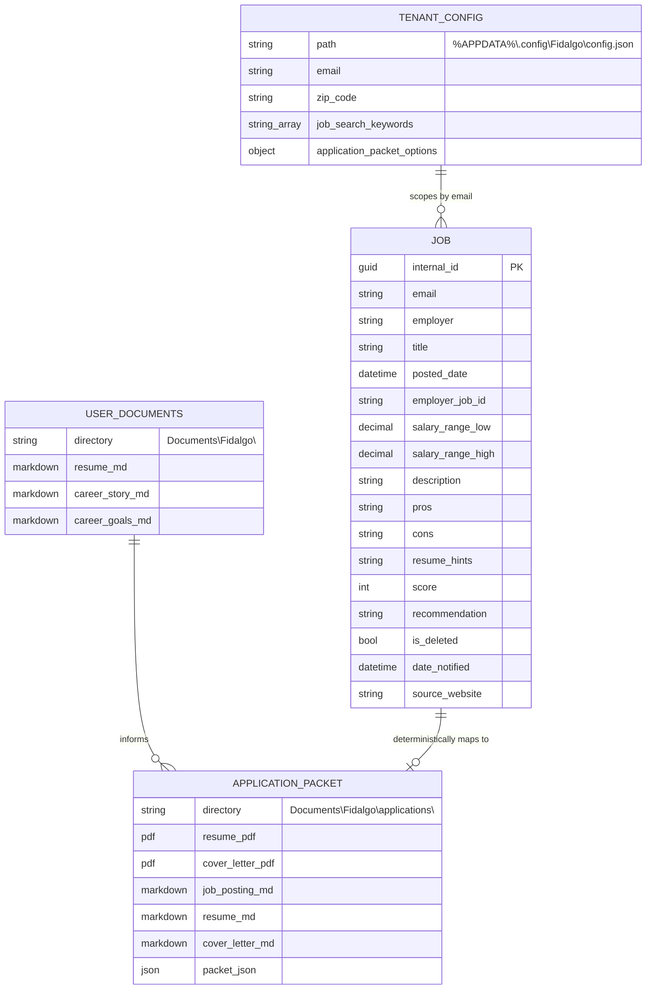

# Entity Relationship & Storage Diagram

## Storage & Entity Descriptions

### `JOB` (`%APPDATA%\fidalgo\jobs.db`)
Single SQLite table (`Jobs`) managed by `JobDbContext` and `JobRepository` with a unique composite index on `(Email, EmployerJobId)`. Stores ingested postings (`Fidalgo.Ingest`) and LLM evaluation fields (`Pros`, `Cons`, `ResumeHints`, `Score`, `Recommendation`) populated by `JobEvaluationAgent`. Soft-deleted jobs set `IsDeleted = true` and are excluded from packet generation (`JobRepository.GetByIdAsync` does not filter `IsDeleted`, so callers check `job is null || job.IsDeleted`).

### `TENANT_CONFIG` (`%APPDATA%\.config\Fidalgo\config.json`)
Optional layered JSON configuration loaded via `UserProfileConfig.AddUserProfileConfig()` across `Fidalgo.Ingest`, `Fidalgo.Agent`, and `Fidalgo.Host`. Provides default `Email`, `ZipCode`, `JobSearchKeywords`, and `ApplicationPacket` settings (`ProfileDirectory`, `OutputDirectory`, `AutoGenerateForApply`, `RecommendationFilter`, `ResumePageSize`, `LlmTimeoutSeconds`, `MdToPdfEndpoint`, `MdToPdfEngine`, `PdfTimeoutSeconds`).

### `USER_DOCUMENTS` (`Documents\Fidalgo\`)
User-authored Markdown profile files (`resume.md`, optional `career-story.md`, optional `career-goals.md`) resolved by `UserProfileResolver` and `UserProfileLoader`, with backward-compatible secondary fallback to `%APPDATA%\.config\Fidalgo\` when no explicit `ProfileDirectory` override is configured.

### `APPLICATION_PACKET` (`Documents\Fidalgo\applications\<sanitized-job-folder>\`)
Filesystem-backed per-job application packet requiring **no SQLite schema migration**. Folder names are deterministically derived from `JOB.Employer`, `JOB.Title`, and the first 8 hex characters of `JOB.InternalId` (`ApplicationPacketPaths.BuildJobFolderName`), enabling idempotent skip/force semantics without storing paths in SQLite.
